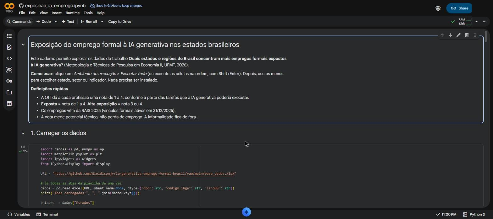
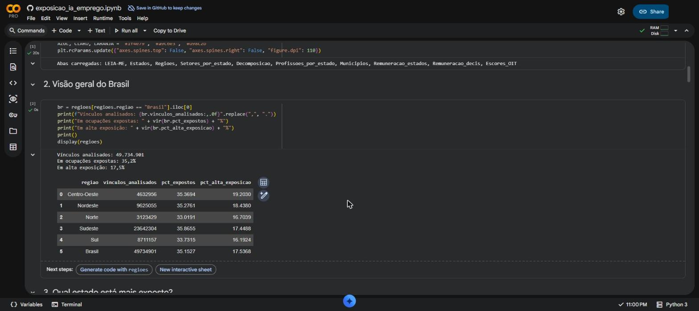
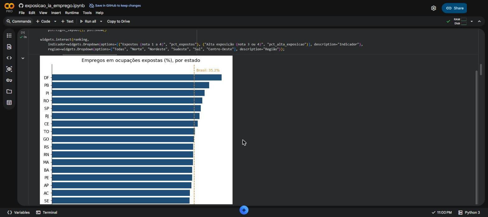
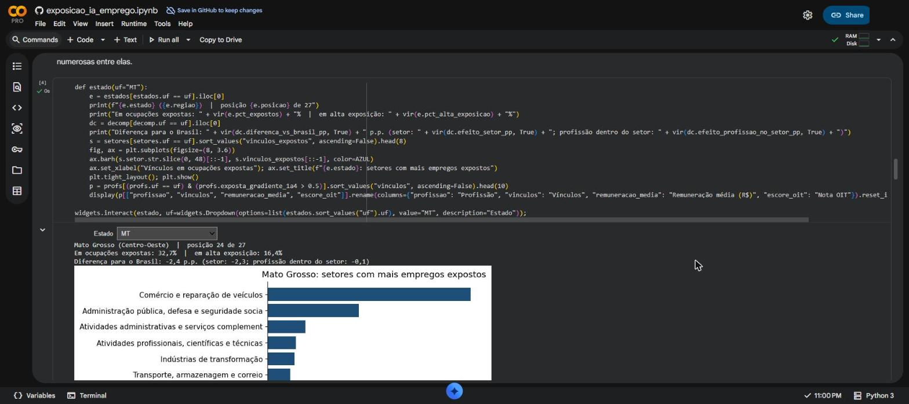
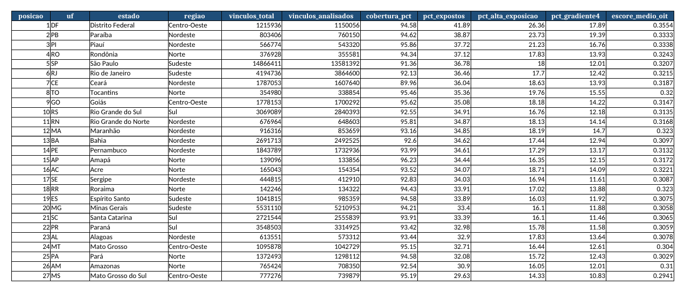
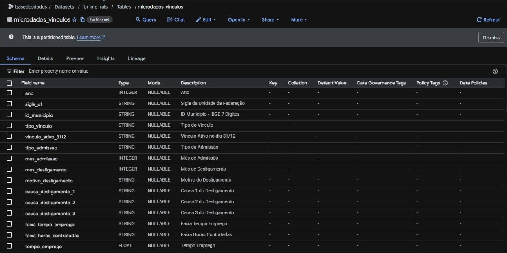

# Exposição do emprego formal à IA generativa nos estados brasileiros

Trabalho da disciplina *Metodologia e Técnicas de Pesquisa em Economia II* (Ciências Econômicas, UFMT, 2026). Integrantes: Eduardo Melo, Gleidison Jr, Guilherme Rocha e Nicolas Ferreira. Professora: Carla Cristina Rosa de Almeida.

**Pergunta:** quais estados e regiões do Brasil concentram mais empregos formais expostos à IA generativa?

**Resposta curta:** 35,2% dos vínculos formais estão em profissões expostas (17,5% em alta exposição). O Distrito Federal tem o maior valor (41,9%) e Mato Grosso do Sul, o menor (29,6%).

## Painel interativo

**[Abrir o painel](https://gleidisonjr.github.io/ia-generativa-emprego-formal-brasil/)**: mapa clicável por estado, comparação entre estados, busca pela sua profissão e ranking dos municípios. Funciona no celular, sem instalar nada.

## Comece por aqui

| Quero... | Abra |
|---|---|
| Explorar os dados de forma interativa, sem instalar nada | [Caderno no Google Colab](https://colab.research.google.com/github/Gleidisonjr/ia-generativa-emprego-formal-brasil/blob/main/exposicao_ia_emprego.ipynb) |
| Ver tudo no Excel, em um único arquivo | [`base_dados.xlsx`](https://github.com/Gleidisonjr/ia-generativa-emprego-formal-brasil/raw/main/base_dados.xlsx) (clique em *Download raw file*) |
| Ler o trabalho | `docs__trabalho.pdf` |

## Como fica

**Google Colab:** abre sem instalar nada, carrega a base sozinho e tem menus para explorar.

**Excel:** todas as tabelas em um arquivo, com filtros (aba Estados abaixo).

**BigQuery:** os empregos vêm da tabela de vínculos da RAIS na Base dos Dados, consultada com SQL (arquivos `sql__`).

### O que tem no Excel (`base_dados.xlsx`)

Uma aba por tabela, com filtros e primeira linha fixa. A aba *LEIA-ME* explica cada uma.

| Aba | Conteúdo |
|---|---|
| Estados | % de vínculos expostos e em alta exposição, por estado |
| Regioes | Resumo por região e Brasil |
| Setores_por_estado | Vínculos por estado e setor (CNAE) |
| Decomposicao | Quanto da diferença de cada estado vem do setor e quanto vem da profissão |
| Profissoes_por_estado | Vínculos, remuneração e exposição por estado e profissão |
| Municipios | Exposição por município |
| Remuneracao_estados e Remuneracao_decis | Remuneração e exposição |
| Escores_OIT | Notas originais da OIT por ocupação |

### O que dá para fazer no Colab

- Ver o ranking dos estados e filtrar por região.
- Escolher um estado e ver setores e profissões que mais pesam.
- Comparar dois estados.
- Ver, para cada setor, em quais estados ele é mais exposto.
- Cruzar exposição e remuneração.
- Listar os municípios mais e menos expostos.
- Escrever as próprias consultas na última célula.

## Como foi feito

1. **Nota por profissão.** A OIT (Gmyrek et al., 2025, *ILO Working Paper 140*) dá a cada ocupação da ISCO-08 uma nota de 1 a 4. "Exposta" = nota 1 a 4; "alta exposição" = nota 3 ou 4.
2. **Empregos.** RAIS 2025, vínculos ativos em 31/12/2025, por estado, profissão (CBO-2002) e setor (CNAE), consultados no BigQuery (Base dos Dados).
3. **Ligação entre as listas.** CBO-2002 para ISCO-88 e depois ISCO-08, pela tabela de correspondência do Ministério do Trabalho (pacote `ocupacoesBR`). Cobriu cerca de 93% dos vínculos.
4. **Cálculo.** Percentual de vínculos expostos por estado, região e setor; decomposição das diferenças entre estados; análise espacial por município; comparação com remuneração.

## Outros arquivos

O envio pelo navegador não aceita pastas, então o prefixo indica o grupo:

| Prefixo | Conteúdo |
|---|---|
| `dados__` | Tabelas intermediárias em CSV, usadas pelos scripts (colunas com os nomes originais) |
| `sql__` | Consultas rodadas no BigQuery |
| `scripts__` | Código Python dos cálculos e das figuras |
| `figuras__` | Figuras do trabalho |
| `docs__` | Versão em PDF do trabalho |

Para refazer os cálculos, baixe os dados brutos (links abaixo) e ajuste, nos scripts, os nomes das pastas `dados_brutos/` e `saida/`. Para apenas usar os resultados, o Excel e o Colab bastam.

## Limitações

- A nota mede potencial técnico de a IA executar tarefas, não perda de emprego.
- A RAIS cobre só o emprego formal; a informalidade fica de fora.
- Cerca de 7% dos vínculos não tiveram correspondência entre as listas de profissões. Tratando-os como não expostos, o total nacional cai para 32,7%; conforme a hipótese, varia de 30,4% a 35,2%.

## Fontes

- GMYREK, P. et al. *Generative AI and jobs: a refined global index of occupational exposure*. Genebra: OIT, 2025. (ILO Working Paper 140).
- BASE DOS DADOS. RAIS: microdados de vínculos (`basedosdados.br_me_rais.microdados_vinculos`). https://basedosdados.org
- Pacote `ocupacoesBR` (tabelas CBO-2002 e ISCO).
- DUQUE, D. *Inteligência artificial generativa e mercado de trabalho no Brasil*. Blog do IBRE/FGV, 27 abr. 2026.
